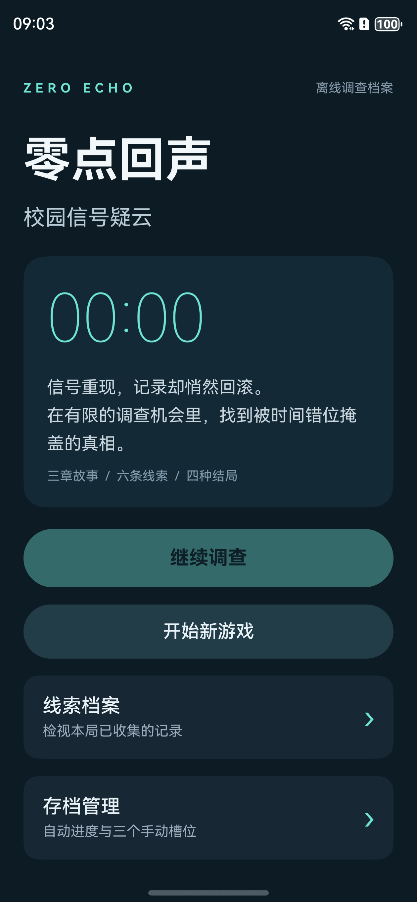
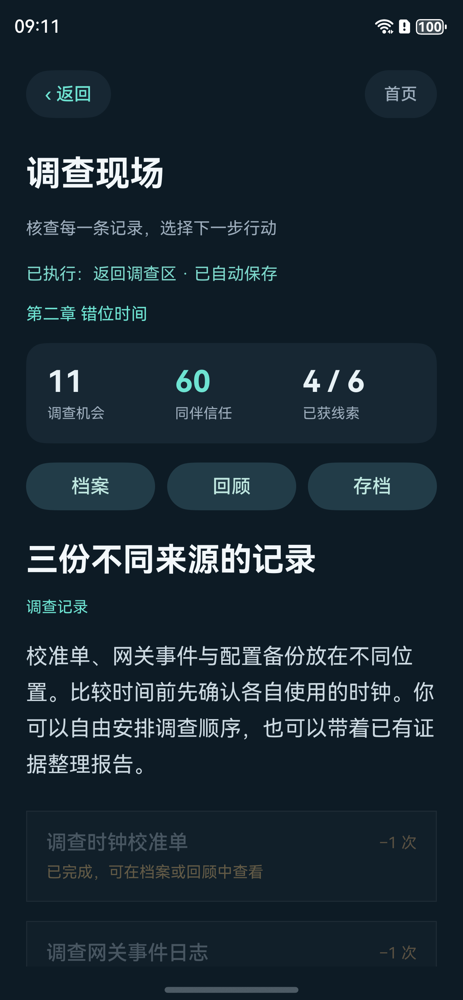
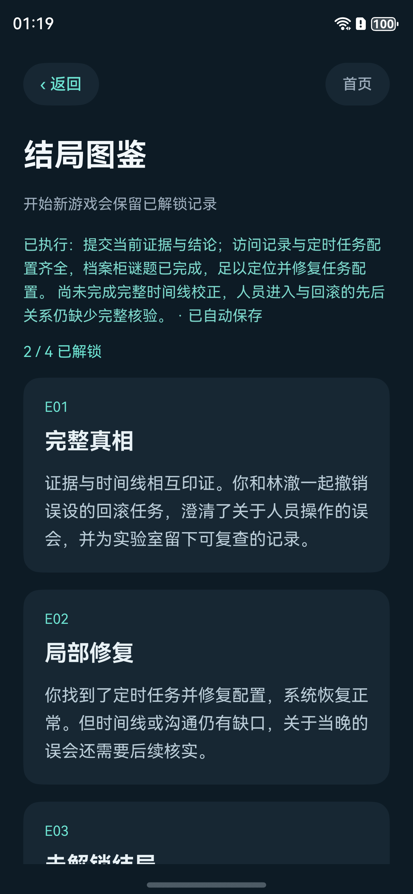

# 零点回声 校园信号疑云

HarmonyOS 原生离线剧情探索应用，移动应用开发基础主题一。玩家调查虚构校园实验室的零点回滚事件，收集证据、校准时钟、选择沟通方式，并依据实际状态得到不同结局。

## 当前状态

已实现三章17个节点（含4结局）、6条线索、2个谜题、条件分支、决策回顾、1个自动档、3个手动档、结局图鉴和大字阅读设置。ArkTS编译与HAP打包通过。单元测试和设备验收的真实状态以 [测试结果](docs/test-results.md)、[当前进度](docs/progress.md) 为准。

[观看带中文字幕的模拟器演示（MP4，3分32秒）](docs/evidence/zero-echo-demo.mp4)。前半段从新游戏开始，展示错答、进程重启及独立调查；后半段在同一中段存档上比较两个结局。若仓库页面只显示文件信息，可以下载原文件播放。

<p>
  <a href="docs/screenshots/01-home.png"></a>
  <a href="docs/screenshots/05-investigation.png"></a>
  <a href="docs/screenshots/14-gallery.png"></a>
</p>

|观察点|实际结果|
|---|---|
|从起点到终局|43 项 Hypium 测试全部通过，T23 用合法动作到达全部四种结局|
|同一中段存档走不同路线|信任均为 60；校正时间线得[完整真相](docs/screenshots/10-ending-e01.png)，只补查配置得[局部修复](docs/screenshots/13-ending-e02.png)|
|存储与恢复|两次结束进程再启动，完整自动档分别相等；测试槽 3 的截断主文件可显式读副本恢复。详见[设备验收](docs/device-acceptance.md)|
|可复现构建|从新检出的源码同步依赖、打包并复测 43/43。该 HAP 已覆盖安装到 API17 模拟器并打开原有进度。[交付包实测](docs/evidence/delivery-build-check.json)|

更多页面可查看[首页](docs/screenshots/01-home.png)、[线索详情](docs/screenshots/15-clue-detail.png)、[时间线谜题](docs/screenshots/09-timeline.png)、[手动存档](docs/screenshots/06-saves.png)、[决策回顾](docs/screenshots/12-history.png)和[结局图鉴](docs/screenshots/14-gallery.png)。

## 开发与运行

- 已验证工具链：DevEco Studio 5.0.13.240，HarmonyOS SDK 5.0.5/API17（5.0.5.165）。
- Node 18.20.1、JBR Java17.0.12、ohpm5.0.19、Hvigor5.17.6，来自DevEco安装目录。
- 本地测试：@ohos/hypium1.0.21，通过Hvigor Local Test/SDK Previewer执行。
- 设备目标：API17 x86_64模拟器Huawei_Phone，应用包名 `com.twistzz89.zeroecho`，Ability名 `EntryAbility`。

本地交付包解压后，在 DevEco Studio 打开含 build-profile.json5 的 ZeroEcho 文件夹。远程同步后也可从 [Twistzz89/ZeroEcho](https://github.com/Twistzz89/ZeroEcho) 克隆。首次打开等待依赖同步，选择 API17 手机模拟器，在工具栏运行 entry 模块。也可在工程根目录执行下列 PowerShell 命令，将安装目录替换为本机路径。

```powershell
& 'D:\Huawei\DevEco Studio\tools\ohpm\bin\ohpm.bat' install
.\scripts\build.ps1 -DevEcoHome 'D:\Huawei\DevEco Studio' -Task sync
.\scripts\build.ps1 -DevEcoHome 'D:\Huawei\DevEco Studio' -Task build
.\scripts\build.ps1 -DevEcoHome 'D:\Huawei\DevEco Studio' -Task test
```

HAP 生成在 `entry/build/default/outputs/default/entry-default-unsigned.hap`。本次交付的 HAP 已在课程模拟器安装。若只想试玩，可启动 API17 手机模拟器，在解压目录执行以下命令。连接多台设备时，在 hdc 命令后加入 `-t 设备标识`。真机运行需在本机配置对应的调试签名。

```powershell
$hdc = 'D:\Huawei\DevEco Studio\sdk\default\openharmony\toolchains\hdc.exe'
& $hdc list targets
& $hdc install -r '.\零点回声-API17-模拟器版.hap'
& $hdc shell aa start -a EntryAbility -b com.twistzz89.zeroecho
```

## 玩法和核心规则

新游戏18次调查机会、50点信任。共享信息增加10信任；无证据指责降低10。每个操作显示明确成本，阅读档案、菜单和普通返回不扣机会。信任会改变同伴协助入口和配置备份的获取条件。所有选择由领域引擎校验，页面不能直接发放线索。

档案柜输入四位字符串0417；时间线谜题提交00:00和“任务先发生”。格式无效不扣费；合法错误答案扣1次。重复线索和已解谜题不重复奖励。四个结局按耗尽优先、总结节点证据与信任条件判定；见 [合法结局路线](docs/ending-routes.md)。

每个有效业务变化保存完整状态和历史。只有保存成功才更新界面状态，失败保留旧进度并允许重试。主存档损坏或无法读取时显示有效副本恢复入口。自动档、3个手动槽和Profile分离；新游戏保留图鉴，全部清空需要两次确认。详见 [架构与存储](docs/architecture.md)。

## 工程结构

|目录|内容|
|---|---|
|entry/src/main/ets/models|强类型数据模型与状态复制|
|entry/src/main/ets/domain|条件、谜题、结局、迁移与历史一致性校验|
|entry/src/main/ets/data|本地剧情、串行存档、沙箱文件适配|
|entry/src/main/ets/viewmodels|初始化、动作、保存和图鉴协调|
|entry/src/main/ets/pages 和 components|原生Navigation页面与复用组件|
|entry/src/test|Hypium正常、边界、异常用例及I/O替身|
|docs|需求、规则、实际测试、截图及构建证据|

## 贡献与交付

负责人为卢广阔，24物联2，GitHub 账号为 Twistzz89，独立项目，无组员。Codex 辅助生成和调试代码、测试及文档，并协助设备验证和报告排版。本人负责理解实现、核对材料和演示。[模块与提交对应关系](docs/contributions.md)

本地工程保留完整 Git 历史。用户选择稍后同步，目标为 [Twistzz89/ZeroEcho](https://github.com/Twistzz89/ZeroEcho)。报告位于本地交付目录。提交学习通前请确认教师能打开仓库和录屏，答案处同时填写有效仓库链接与本人账号名。电子截止时间以教师通知为准。

## 限制

本次验证覆盖 API17 手机模拟器，跨 API 和实体手机适配仍待验证。存档 JSON 限制为 524288 字符，文件限制为 1 MiB UTF-8 字节。普通 E01 路线样本约 4 KB。极长的免费往返会增加历史长度，超限时应用拒绝保存并保留原有进度。首次快速重启遇到的模拟器渲染超时和后续成功结果均记录在[设备验收](docs/device-acceptance.md)。

剧情、角色、校名和日志为虚构，图标为本项目SVG；参考与模板来源见 [references](docs/references.md)。
