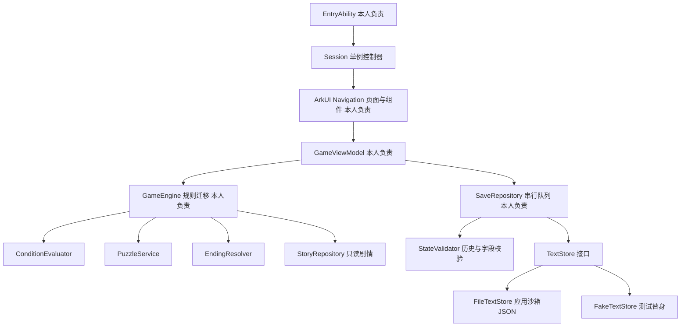
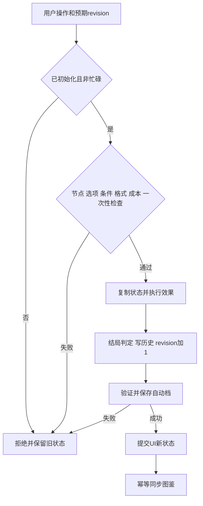

# 系统架构和数据流

负责人：卢广阔（本人负责整体工程，Codex辅助实现与验证；没有组员）。

## 模块和接口

|模块|主要接口|输入输出和边界|
|---|---|---|
|StoryRepository|createStory / validateStory|生成并检查本地强类型剧情；无效ID、引用、条件、效果拒绝|
|GameEngine|dispatch / getAvailableChoices|旧状态+带revision动作→新副本/明确失败；原对象不直接改写|
|ConditionEvaluator|evaluateConditions|all成立且非空any至少一项成立；未知条件拒绝|
|PuzzleService|checkPuzzle|业务答案字符串与顺序ID→格式合法性及正确性|
|EndingResolver|resolveEnding / explainEnding|耗尽先于总结提交；依据真实状态解释结局|
|StateValidator|validateState|先检查字段类型、范围、引用，再按历史重建并比较状态|
|SaveRepository|save / load / deleteSlot / loadProfile|完整带版本记录；区分empty/valid/corrupt/incompatible/error|
|FileTextStore|read / writeAtomic|应用filesDir中的固定前缀文件；拒绝路径穿越与过大文件|
|GameViewModel|initialize / act / newGame / loadSlot|启动读完才开放业务；忙碌锁、保存后提交、图鉴补记|

## 一次有效操作

## 保存和恢复协议

SaveRepository用单个Promise队列串行写入。每个槽保留主文件和一个备份；保存前仅把验证有效的旧主文件写入备份。FileTextStore对临时文件完整写入、fsync、读回比较，再同目录rename替换主文件。这里的保证限于单文件替换与正常操作系统语义；不声称槽和Profile多文件构成事务，也不声称突然断电的物理介质绝对不丢失数据。

读取先检查schemaVersion与contentVersion，再深度校验GameState。主文件格式错误、为空或读取失败时检查备份，用户确认后恢复。明确的删除标记不自动复活副本。删除和清空按槽执行，失败报告部分完成状态，不假称跨文件原子清空。图鉴独立于单局；如果结局档已落盘而图鉴中断，初始化从有效槽补记，数组去重确保幂等。

所有关键写入发生在业务动作完成时，EntryAbility.onBackground不承担退出保存。V1状态管理通过页面将成功提交的状态复制并赋值给@State，驱动组件刷新。Session保证页面共用一个控制器和写队列。

## 当前设计取舍

剧情采用只读ArkTS配置而非外部JSON，便于强类型检查；存档仍是带版本JSON。节点规模17个以可验证流程为准。免费节点往返记录历史但不扣调查机会；过长历史达到限制时拒绝写入，后续可增加无业务变化导航的历史压缩。
